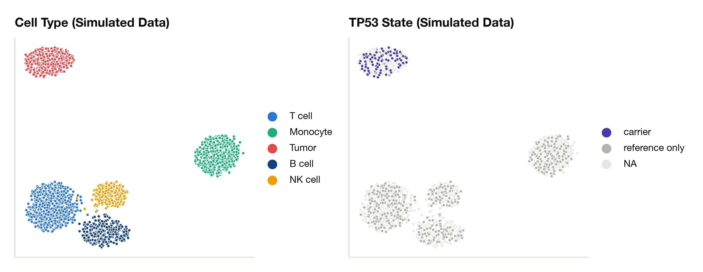

---

[](http://bioconda.github.io/recipes/annatar/README.html)
[](http://bioconda.github.io/recipes/annatar/README.html)
[](https://pypi.org/project/annatar/)
[](https://github.com/clintval/annatar/actions/workflows/ci.yml?query=branch%3Amain)
[](https://github.com/clintval/annatar/blob/main/LICENSE)
[](https://www.rust-lang.org/)

Convert a multi-sample VCF of single cells into an AnnData h5ad.

Install with pip, mamba, conda, or run directly with pixi:

```bash
pixi exec \
    --channel conda-forge \
    --channel bioconda \
    annatar --help
```

## Introduction

The tool `annatar` reads a multi-sample VCF or BCF, with cells as samples, and writes one h5ad with cells by variants.
Each ALT allele becomes a variant, and numeric FORMAT fields become sparse layers.
VEP annotation is optional. When the VCF has `INFO/CSQ`, one consequence per variant becomes typed columns in `var`.
The h5ad can sit next to other single-cell modalities in a `MuData` keyed on cell barcode.

## Quick Start

Convert a VCF of cells:

```bash
annatar 'cells.vcf.gz' 'cells.h5ad'
```

For a VEP-annotated VCF, prioritize effects in a gene set and leave out CSQ subfields:

```bash
annatar \
    --genes 'panel-genes.txt' \
    --exclude-field 'INFO/CSQ/Existing_variation' \
    --exclude-field 'INFO/CSQ/SOMATIC' \
    'cells.vep.vcf.gz' \
    'cells.h5ad'
```

Excluding `INFO/CSQ` drops all VEP annotation.

## Merging Libraries

Merge the h5ad files of several libraries into one:

```bash
annatar merge --output 'merged.h5ad' 'a.h5ad' 'b.h5ad'
```

Cells become `barcode-library`, named after each file, and `obs['library']` holds the library's name.
Variants are the union of the libraries, sorted by VCF header contig order, then `start`, `end`, `ref` and `alt`.
The columns `n_cells_covered`, `n_cells_alt`, `ref_reads` and `alt_reads` are recounted from the merged layers.
Any other `var` value on a shared variant, such as `qual` or an INFO field, comes from the first library holding it, and later libraries fill only the columns that library lacks entirely.
A column that is text in one library and numeric in another stays text.
The `X` matrix and the layers keep every stored value, since neither stores a zero.

## Python

Convert a VCF into an in-memory AnnData:

```python
import annatar

adata = annatar.read_vcf('cells.vcf.gz')
```

Merge libraries into an in-memory AnnData:

```python
merged = annatar.concat(['a.h5ad', 'b.h5ad'])
```

## Output

| Slot | Contents |
| --- | --- |
| `X` | Copies of each ALT in each cell's called genotype, capped at its read count |
| `layers` | Numeric FORMAT fields, such as `AD_ref`, `AD_alt` and `DP` |
| `obs` | Per-cell counts, `n_sites_covered` and `n_sites_alt` |
| `var` | One row per ALT allele, named `chrom:pos:ref:alt` |
| `uns` | Provenance and the encoding of `X` |

#### Genotypes

The `X` matrix holds the number of copies of the ALT in the called genotype, capped at that ALT's read count, so `0/1` is 1, and `1/1` is 2 with two or more alt reads and 1 with one.
Hom-ref and uncalled cells are not stored, and neither is a call with no alt reads.
A missing alt count (`.`) cannot cap anything, so that call keeps its copies.
So `X > 0` means a called carrier with alt reads, and `X.sum()` never exceeds the alt reads that were counted.
A haploid ALT call is 1, so `X == 2` does not find it.

Layers are read counts, with zeros and missing values not stored.
At a variant a cell is a carrier (`X > 0`, or `AD_alt > 0` for reads), reference (`AD_ref > 0` with no `X` or `AD_alt`), or has no data.
A cell with reads but no call keeps them in the layers, and `AD_alt` counts alt reads in cells called `0/0`.

#### Variants

The `start` and `end` columns are 0-based and half-open, as in BED, while a variant's `chrom:pos:ref:alt` name keeps the VCF's 1-based position.
Every ALT gets its own row, whether it is an SNV, indel, MNV, symbolic ALT or breakend.
The placeholder alleles `*`, `<*>` and `<NON_REF>` get no row.
The VCF must declare `FORMAT/AD`.

#### VEP Annotation

VEP is optional.
When the VCF has `INFO/CSQ`, one consequence per variant is added to `var` with its VEP subfield names, along with these columns:

| Column | Meaning |
| --- | --- |
| `consequence_rank` | Severity of the consequence, where lower is more severe |
| `is_coding` | The consequence is coding |
| `is_lof` | The consequence is loss of function |
| `pick_tier` | `mane_select`, `mane_plus_clinical`, `canonical` or `other` |
| `worst_panel_impact` | Highest `IMPACT` among the `--genes` panel genes |

Column types are fixed for VEP 116, so a column has the same type in every file.
Other VEP versions run with a warning.

> [!IMPORTANT]
> Split multiallelic records before running VEP, not after.
> annatar stops on evidence of a split after VEP, including a `bcftools norm` split line in the header, even if no record changed.
> It cannot detect a split after `--pick` when neither `--allele_number` nor that header line is there.
> annatar refuses `--minimal` output, so run VEP without it.
> Pass `--allele_number` to VEP so symbolic ALTs and breakends match by position.

## MuData Example

Color the cells that carry a pathogenic TP53 variant on a chromatin UMAP, with a VCF and a chromatin h5ad in `docs/example/` that share cell barcodes.
Both files are simulated, because this project has no real dataset yet that links chromatin to mutations by cell barcode, so read the figure as a demonstration and not a result.

From a clone of this repository, convert the VCF:

```bash
annatar 'docs/example/cells.vcf.gz' 'cells.h5ad'
```

A `MuData` object lines the modalities up by cell barcode, and cells with no reads at these variants stay gray:

```python
import anndata as ad
import mudata as md
import muon
import numpy as np

mu = md.MuData({'atac': ad.read_h5ad('docs/example/cells.atac.h5ad'), 'variants': ad.read_h5ad('cells.h5ad')})

variants = mu['variants']
pathogenic = {'Pathogenic', 'Likely_pathogenic', 'Pathogenic/Likely_pathogenic'}
hits = (variants.var['SYMBOL'] == 'TP53') & variants.var['ClinVar_CLNSIG'].isin(pathogenic)
alt = np.asarray(variants[:, hits].layers['AD_alt'].sum(axis=1)).ravel()
ref = np.asarray(variants[:, hits].layers['AD_ref'].sum(axis=1)).ravel()
variants.obs['TP53'] = np.select([alt > 0, ref > 0], ['carrier', 'reference only'], default=None)

mu.pull_obs()
colors = {
    'T cell': '#2a78d6', 'Monocyte': '#1baf7a', 'Tumor': '#e34948', 'B cell': '#104281', 'NK cell': '#eda100',
    'carrier': '#4a3aa7', 'reference only': '#b5b1ab',
}
muon.pl.embedding(
    mu,
    basis='atac:X_umap',
    color=['atac:cell_type', 'variants:TP53'],
    title=['Cell Type (Simulated Data)', 'TP53 State (Simulated Data)'],
    palette=colors,
    na_color='#e9e7e2',
    size=18,
    edgecolor='white',
    linewidth=0.35,
    frameon=False,
)
```



## Development and Testing

See the [contributing guide](https://github.com/clintval/annatar/blob/main/CONTRIBUTING.md) for more information.
