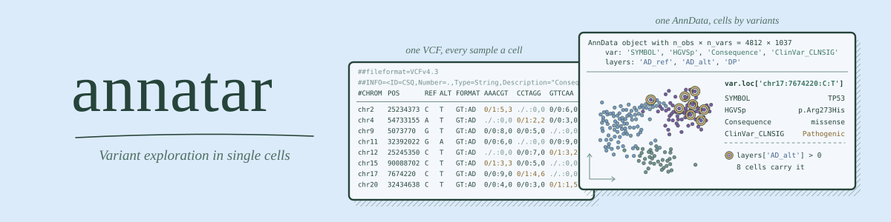

---

[](https://github.com/clintval/annatar/actions/workflows/ci.yml?query=branch%3Amain)
[](LICENSE)
[](https://www.rust-lang.org/)

Convert a multi-sample VCF of single cells into an AnnData h5ad.

Install from GitHub with Rust and `cmake`, which builds the bundled HDF5:

```bash
cargo install --locked --git https://github.com/clintval/annatar
```

## Introduction

The tool `annatar` reads a multi-sample VCF or BCF, with cells as samples, and writes one h5ad with cells by variants.
Each ALT allele becomes a variant, and numeric FORMAT fields become sparse layers.
VEP annotation is optional. When the VCF has `INFO/CSQ`, one consequence per variant becomes typed columns in `var`.
The h5ad can sit next to other single-cell modalities in a `MuData` keyed on cell barcode.

## Quick Start

Convert a VCF of cells:

```bash
annatar --output 'cells.h5ad' 'cells.vcf.gz'
```

For a VEP-annotated VCF, prefer panel genes and leave out CSQ subfields:

```bash
annatar \
    --genes 'panel-genes.txt' \
    --exclude-field 'CSQ/Existing_variation' \
    --exclude-field 'CSQ/SOMATIC' \
    --output 'cells.h5ad' \
    'cells.vep.vcf.gz'
```

A field passed to `--exclude-field` must be declared in the VCF header, or annatar exits with an error.
A `CSQ/` field only warns when the header has no `INFO/CSQ`, so one command serves annotated and plain VCFs.
Excluding `INFO/CSQ` drops all annotation. The fields `FORMAT/AD` and `FORMAT/GT` cannot be excluded.

Read from standard input:

```bash
bcftools view 'cells.bcf' \
| annatar --output 'cells.h5ad'
```

## Output

| Slot | Contents |
| --- | --- |
| `X` | Genotype of each cell at each variant |
| `layers` | Numeric FORMAT fields, such as `AD_ref`, `AD_alt` and `DP` |
| `obs` | Per-cell counts, `n_sites_covered` and `n_sites_alt` |
| `var` | One row per ALT allele, named `chrom:pos:ref:alt` |
| `uns` | Provenance and the encodings used in the file |

### Genotypes

| Value in `X` | Meaning |
| --- | --- |
| not stored | no genotype |
| 1 | no copies of this ALT |
| 2 | one copy of this ALT |
| 3 | two or more copies of this ALT |

In a layer, a stored `0` is a measured zero and an unstored entry means no data.

### Variants

Every ALT gets its own row, whether it is an SNV, indel, MNV, symbolic ALT or breakend.
The placeholder alleles `*`, `<*>` and `<NON_REF>` get no row.
The VCF must declare `FORMAT/AD`.

### VEP Annotation

VEP is optional.
When the VCF has `INFO/CSQ`, one consequence per variant is added to `var` with its VEP subfield names, along with these columns:

| Column | Meaning |
| --- | --- |
| `consequence_rank` | Severity of the consequence, where lower is more severe |
| `is_coding` | The consequence is coding |
| `is_lof` | The consequence is loss of function |
| `pick_tier` | `mane_select`, `mane_plus_clinical`, `canonical` or `other` |
| `worst_panel_impact` | Highest `IMPACT` among the `--genes` panel genes |

Column types are fixed for VEP 116, so a column has the same type in every file.
Other VEP versions run with a warning.

Split multiallelic records before running VEP, not after.
Pass `--allele_number` to VEP if you use `--minimal`.

## Merging Libraries

Merge the h5ad files of several libraries into one AnnData.
`anndata.concat` loses `var` annotation when the files hold different variants, so rebuild `var` from the inputs:

```python
import anndata as ad
import pandas as pd

libraries = {'a': ad.read_h5ad('a.h5ad'), 'b': ad.read_h5ad('b.h5ad')}
adata = ad.concat(libraries, join='outer', label='library', index_unique='-')
var = pd.concat([library.var for library in libraries.values()])
adata.var = var[~var.index.duplicated()].reindex(adata.var_names)
```

After merging, two things change.

- Read counts in `var`, such as `alt_reads`, describe the first file with that variant.
- Layers lose their stored zeros if the files hold different variants, so an unstored `AD_alt` no longer means an uncovered cell.

## MuData Example

Color the cells that carry a pathogenic TP53 variant, next to a chromatin modality that shares the cell barcodes:

```python
import anndata as ad
import mudata as md
import numpy as np

variants = ad.read_h5ad('cells.h5ad')
atac = ad.read_h5ad('cells.atac.h5ad')
mu = md.MuData({'atac': atac, 'variants': variants})

pathogenic = {'Pathogenic', 'Likely_pathogenic', 'Pathogenic/Likely_pathogenic'}
hits = (variants.var['SYMBOL'] == 'TP53') & variants.var['ClinVar_CLNSIG'].isin(pathogenic)
carriers = np.asarray(variants[:, hits].layers['AD_alt'].sum(axis=1)).ravel() > 0
```

## Development and Testing

See the [contributing guide](./CONTRIBUTING.md) for more information.
